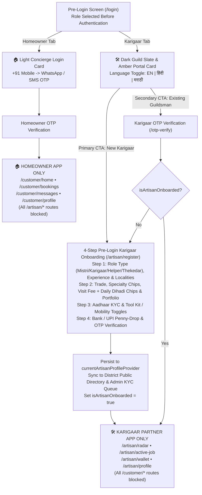

# Karigaar Artisan Trust — Master Project Blueprint

---

## 1. Project Overview & Architectural Vision

**Karigaar** is an on-demand, hyperlocal home services platform engineered specifically for the Indian trade craftsmanship ecosystem (electricians, plumbers, carpenters, appliance mechanics, masons, painters). Karigaar resolves the fundamental tension in the Indian residential maintenance sector: **the conflict between informal offline hiring (personal trust, direct negotiation, cash/direct UPI) and structured platform guarantees (police background vetting, transparent rate cards, escrow-backed warranty, live dispatch tracking).**

The platform operates on a **"Master Guildsman Meets Modern Concierge"** archetype, unifying:
- **Dual Engagement Paths**: 
  - **Path A (Direct Contact / Open Directory)**: Enables high-autonomy customer discovery of verified master craftsmen with transparent inspection rate cards and portfolio showcases. Monetized via founder-selected options (Directory Pass at ₹499/mo, Pay-Per-Lead unlock at ₹49–₹99, or Virtual Click-to-Call paywall) and protected against leakage via Virtual Masked Telephony (`/api/v1/telephony/bridge-call`).
  - **Path B (Structured Booking / Managed Marketplace)**: An end-to-end, escrow-protected 16-state workflow featuring multi-modal scoping (photo + 15s audio memo), upfront pre-authorization / UPI mandate at booking confirmation (guaranteeing the ₹99 transit cancellation fee), a 45-second circular countdown Job Radar broadcast with fallback to `DISPATCH_UNFULFILLED`, live GPS turn-by-turn tracking, doorstep exception handling (`DOORSTEP_ACCESS_DENIED`), dual-stage security OTP verification (Start Code `4921` + customer Completion OTP), RBI 2FA customer approval for on-site spare parts, 2% parts gateway convenience surcharge, decoupled invoice submission (`POST /submit-invoice`) and completion verification (`POST /verify-completion`), and instant IMPS settlement governed by a ₹2,000 rolling security reserve (or 24h settlement hold).
- **Two-Tier Damage Protection & Warranty Solvency**:
  - **Base Coverage (Included in ₹29 Platform Safety Fee)**: ₹10,000 property damage guarantee for all standard Path B bookings and Verified Pro artisans.
  - **Comprehensive Master Cover (₹25,000)**: Automatically unlocked for Master Guildsman assignments or as a premium add-on. Supported by a mandatory **₹250 customer deductible** to deter frivolous claims, with **30% of platform labor take-rate** reserved into a dedicated Warranty & Rework Underwriting Fund.
- **Sustainable Guild Tier Economics**: Replaces negative-margin 0% tiers with a sustainable **5% commission floor** or a **₹999/month "Guild Elite" subscription** for Master Guildsmen, maintaining positive unit economics across payment gateway MDR, IMPS payout fees, WhatsApp messaging, and telephony bridges.
- **WhatsApp-First Messaging Spine & Telephony Masking**: Replaces friction-heavy SMS/app-only communication with WhatsApp Cloud API integration for 1-tap authentication, real-time dispatch alerts, voice note streaming, and daily settlement slips, paired with virtual telephony proxy bridges that eliminate raw phone number leakage.
- **Geographic Focus**: Primary operational pilot launched in **Nanded, Maharashtra** (`431601`–`431606`, 10 Localities) and expanded into the **7-District Regional Corridor** (Nanded, Parbhani, Latur, Hingoli, Chhatrapati Sambhajinagar, Nagpur, Nizamabad) via Ticket T-01, with a planned expansion trajectory to Gurugram / NCR, Bengaluru, Mumbai, and pan-India metropolitan centers.

---

## 2. System Architecture

```
┌─────────────────────────────────────────────────────────────────────────────────────────────────┐
│                                         CLIENT LAYER                                            │
├───────────────────────────────┬───────────────────────────────┬─────────────────────────────────┤
│ Customer Mobile App           │ Partner Mobile App            │ Super Admin Operations Console  │
│ (Flutter iOS/Android)         │ (Flutter iOS/Android)         │ (Next.js / Responsive Web & PWA)│
│ • Hyperlocal Discovery & Maps │ • Job Radar (45s Timer)       │ • HQ Live Pulse Telemetry       │
│ • Service Scoping & Audio Memo│ • Foreground GPS Telemetry    │ • Priority KYC Review Queue     │
│ • Live Map & Start OTP (4921) │ • Dynamic Invoicing & Receipt │ • Surge Grid Heatmap Engine     │
│ • Dual Path A / Path B Choice │ • Guild Wallet & IMPS Payout  │ • WhatsApp Outbound Dispatcher  │
└───────────────┬───────────────┴───────────────┬───────────────┴─────────────────┬───────────────┘
                │                               │                                 │
                ▼                               ▼                                 ▼
┌─────────────────────────────────────────────────────────────────────────────────────────────────┐
│                            API GATEWAY & EDGE INGRESS (Traefik / Envoy)                         │
│   • SSL Termination • JWT Token Verification • Rate Limiting (Redis) • Role-Based Ingress       │
└───────────────────────────────────────────────┬─────────────────────────────────────────────────┘
                                                │
    ┌───────────────────────────┬───────────────┴───────────────┬───────────────────────────┐
    ▼                           ▼                               ▼                           ▼
┌─────────────────┐     ┌─────────────────┐             ┌─────────────────┐     ┌─────────────────┐
│  Auth & Identity│     │  Dispatch Radar │             │ Live Telemetry  │     │ Booking & Escrow│
│     Service     │     │     Service     │             │     Service     │     │     Service     │
├─────────────────┤     ├─────────────────┤             ├─────────────────┤     ├─────────────────┤
│ • WhatsApp OTP  │     │ • 45s Broadcast │             │ • WebSocket/MQTT│     │ • 16-State Life │
│ • +91 Phone Auth│     │ • Radius Engine │             │ • Real-time GPS │     │ • Start OTP 4921│
│ • KYC Tiers 1-3 │     │ • Unfulfilled   │             │ • ETA Polyline  │     │ • Submit/Verify │
│ • DLT Fallback  │     │ • Masked Bridge │             │ • Geofence 200m │     │ • DoorstepDenial│
└────────┬────────┘     └────────┬────────┘             └────────┬────────┘     └────────┬────────┘
         │                       │                               │                       │
         └───────────────────────┼───────────────────────────────┼───────────────────────┘
                                 │                               │
    ┌────────────────────────────┴───────────────────────────────┴──────────────────────────┐
    ▼                                                            ▼                          ▼
┌─────────────────┐                                     ┌─────────────────┐     ┌─────────────────┐
│ Wallet & Ledger │                                     │ WhatsApp & Comms│     │ Super Admin Ops │
│     Service     │                                     │     Service     │     │     Service     │
├─────────────────┤                                     ├─────────────────┤     ├─────────────────┤
│ • Double-Entry  │                                     │ • Meta Cloud API│     │ • Surge 1.4x    │
│ • RBI 2FA Parts │                                     │ • Voice Relay   │     │ • 18-Queue KYC  │
│ • ₹2k Reserve   │                                     │ • DLT SMS Gate  │     │ • Dispute Panel │
│ • Guild Tier 5% │                                     │ • Telephony Prox│     │ • Real-time GMV │
└────────┬────────┘                                     └────────┬────────┘     └────────┬────────┘
         │                                                       │                       │
         ▼                                                       ▼                       ▼
┌─────────────────────────────────────────────────────────────────────────────────────────────────┐
│                                    DATA & EVENT PERSISTENCE                                     │
├───────────────────────────────┬───────────────────────────────┬─────────────────────────────────┤
│ PostgreSQL 16 (Primary RDBMS) │ Redis 7 (In-Memory Cache)     │ Cloud Object Storage (S3 / GCS) │
│ • User Profiles, Tiers & KYC  │ • Radar Dispatch Pub/Sub      │ • MCB / Pipe Defect Photos      │
│ • 16-State Booking Ledger     │ • Active Artisan Geospatial   │ • Customer 15s Audio Notes      │
│ • Invoices, Parts & 2% Sur.   │ • OTP TTLs & Rate Limits      │ • Hardware Store Receipts       │
│ • Double-Entry Guild Accounts │ • Active WebSocket Channels   │ • Aadhaar / Police Certificates │
└───────────────────────────────┴───────────────────────────────┴─────────────────────────────────┘
```

### 2.1 Client Applications
1. **Customer Mobile Application (`apps/customer_mobile`)**:
   - Cross-platform Flutter client deployed to iOS and Android.
   - Persona: Homeowners and residential tenants.
   - Core Modules: Locality picker, 8-trade discovery grid, Emergency 25-minute booking banner, Multi-issue configurator with visual/audio scoping, Upfront UPI mandate pre-authorization dock, Live tracking vector map with two-wheeler marker and 5-stage milestone stepper, Security Start Code display (`4921`), In-app chat drawer with canned gated society chips, RBI 2FA spare parts approval prompt, Completion Verification screen with OTP release, and Karigaar Guild trust profiles.
2. **Partner Mobile Application (`apps/partner_mobile`)**:
   - High-performance Flutter client tailored for blue-collar tradespeople with high-contrast UI and Hindi/English bilingual toggle.
   - Persona: Verified guild artisans (Electricians, Plumbers, Carpenters, AC Technicians).
   - Core Modules: Active/Paused duty toggle, Today's earnings Bento metrics, WhatsApp Dual Sync notification bridge, 45-second circular SVG countdown timer dispatch card, Nearby Job Radar feed with filter pills, Foreground GPS telemetry service, Elapsed job stopwatch, Material & Labor Dynamic Bill Builder with hardware receipt photo attachment, Decoupled Invoice Submission trigger (`POST /submit-invoice`), Doorstep Timeout trigger (`POST /doorstep-access-denied`), and Guild Wallet with instant IMPS bank withdrawal governed by a ₹2,000 rolling security reserve.
3. **Super Admin Web & Mobile Console (`apps/admin_web`)**:
   - Responsive Next.js 14 web application accessible via desktop and mobile browsers.
   - Persona: HQ Operations Managers, Guild Masters, and Dispute Arbitrators.
   - Core Modules: Live Ops pulse stream (active dispatches, available artisans, dispute rate), 2x2 executive KPI bento grid, Surge Grid Alert heatmap (Surge 1.4x), Category volume percentage mix, Priority Guild Verification Queue (Aadhaar, Police clearance, tool calibration audit), Outbound WhatsApp emergency surge broadcast pipeline, Warranty Underwriting Reserve monitor, and Automated CSAT monitor.

### 2.2 Backend Domain Microservices
1. **Auth & Identity Service (`services/auth_service`)**:
   - Manages WhatsApp Cloud API 1-tap authentication, +91 10-digit mobile number input, 6-digit OTP verification with 42-second countdown, and secondary DLT-registered SMS fallback.
   - Issues role-based scoped JWT tokens (`ROLE_CUSTOMER`, `ROLE_PARTNER`, `ROLE_ADMIN`).
   - Implements 3-tier artisan verification progression (Tier 1: Registered, Tier 2: Guild Verified Pro, Tier 3: Master Guildsman).
2. **Dispatch Radar Service (`services/dispatch_radar_service`)**:
   - Governs the real-time job broadcast engine. When a customer confirms a Path B booking, the engine initiates a localized Redis geospatial query (default 3 km radius).
   - Manages the strict **45-second circular countdown timer** per artisan. If unaccepted, auto-cascades to the next nearest qualified artisan. If exhausted without acceptance, transitions booking state to **`DISPATCH_UNFULFILLED`** to trigger auto-expanded re-dispatch (up to 6 km) or graceful customer fallback.
   - Eliminates unmasked phone number exposure by replacing raw `wa.me` links with virtual telephony bridge endpoints (`/api/v1/telephony/bridge-call`) and in-app secure chat proxies.
3. **Geolocation & Tracking Service (`services/geolocation_tracking_service`)**:
   - Ingests high-frequency GPS coordinate streams from the Partner app via WebSockets / MQTT.
   - Computes live road-network route polylines and real-time ETAs.
   - Detects 200-meter proximity geofence arrivals, automatically triggering arrival notifications and arming the 15-minute doorstep timeout timer.
4. **Booking & Escrow Lifecycle Service (`services/booking_escrow_service`)**:
   - Implements the complete **16-state booking lifecycle** state machine.
   - Enforces an upfront pre-authorization / UPI mandate at booking confirmation to ensure the **₹99 transit cancellation fee** is legally and automatically collectible if the customer cancels after dispatch (>3 mins).
   - Manages two-factor OTP handshakes: generates and validates the **Security Start Code (`4921`)** on arrival, and enforces decoupled completion:
     - Artisan submits invoice via `POST /api/v1/bookings/:id/submit-invoice` (moves to `INVOICE_SUBMITTED`).
     - Customer reviews itemized bill on their own screen and releases the **Completion OTP** via `POST /api/v1/bookings/:id/verify-completion`.
   - Handles doorstep exception states: implements **`DOORSTEP_ACCESS_DENIED`** if customer is unreachable or denies entry for >15 minutes after arrival, auto-capturing the ₹99 transit fee (₹80 credited to artisan for fuel/time, ₹19 platform fee) and terminating the job cleanly.
   - Clearly delineates Path A (asynchronous directory contact/bidding lifecycle) from Path B (synchronous managed escrow state machine).
5. **Wallet, Billing & Settlement Service (`services/wallet_settlement_service`)**:
   - Double-entry bookkeeping engine managing upfront UPI mandates, customer escrow holds, platform commissions (12% standard labor take-rate; **sustainable 5% commission floor** or ₹999/month "Guild Elite" subscription for Master Guildsmen), flat ₹29 safety insurance shield fee, and a **2% payment gateway convenience surcharge** on customer payments for pass-through spare parts.
   - Houses the on-site Material & Labor Bill Builder, enforcing **RBI 2FA compliance** by requiring explicit in-app customer approval or secondary OTP before any spare parts or scope expansions can be added to the final invoice.
   - Manages the Guild Wallet with **instant 24/7 IMPS bank withdrawals** (RazorpayX / Cashfree), protected by a mandatory **₹2,000 rolling security reserve** (or 24h settlement hold on newly completed jobs) to defend against instant wallet drain in post-service property damage scenarios.
   - Automatically directs **30% of platform labor take-rate** into a dedicated Warranty & Rework Underwriting Reserve pool, backed by a **₹250 customer deductible** on property damage claims.
6. **WhatsApp & Communications Service (`services/notification_service`)**:
   - Direct integration with Meta's WhatsApp Business Cloud API.
   - Routes dual-sync dispatch payloads (customer audio notes, gate codes, GPS coordinates) and handles virtual telephony masking bridges (`/api/v1/telephony/bridge-call`) to prevent customer MSISDN exposure.
   - Manages outbound emergency surge broadcast alerts and post-service automated 5-star CSAT surveys.
7. **Admin & Operations Governance Service (`services/admin_ops_service`)**:
   - Aggregates operational telemetry for the Super Admin dashboard.
   - Manages dynamic surge pricing multipliers (e.g., 1.4x in DLF Phase 4 during thunderstorm emergencies).
   - Orchestrates the KYC document approval pipeline, warranty reserve claims ledger, and dispute arbitration workflows.

---

## 3. Comprehensive Feature Inventory (34+ Features)

The following master feature inventory consolidates all components identified across all 12 reference UI screens, both engagement paths, and the system architecture:

| ID | Feature Name | Domain / Category | Primary UI Screen | Description | Inputs | Outputs | Target Milestone | Source Artifact |
|---|:---|:---|:---|:---|:---|:---|:---|:---|
| **F-01** | Instant WhatsApp Login | Auth & Onboarding | `login_whatsapp_onboarding` | 1-Tap passwordless authentication via WhatsApp OAuth/API | Phone Number, WhatsApp tap | Session token, redirect to role home | Phase 1 | `login_whatsapp_onboarding` |
| **F-02** | Segmented Role Switcher | Auth & Onboarding | `login_whatsapp_onboarding` | Client-side tab toggle between Homeowner and Karigaar | Click event on role tabs | Modifies view layout & promo banners | Phase 1 | `login_whatsapp_onboarding` |
| **F-03** | 6-Digit OTP Auto-Advance | Auth & Onboarding | `whatsapp_otp_verification_modal` | Interactive OTP input matrix with clipboard paste & keyboard nav | 6 numeric digits, paste text | Auto-focuses next input, triggers submit | Phase 1 | `whatsapp_otp_verification_modal` |
| **F-04** | Resend OTP Countdown | Auth & Onboarding | `whatsapp_otp_verification_modal` | 42s countdown timer disabling resend until expiry | Wall clock time (1s tick) | Timer string, enables active resend button | Phase 1 | `whatsapp_otp_verification_modal` |
| **F-05** | SMS Fallback Trigger | Auth & Onboarding | `whatsapp_otp_verification_modal` | Secondary SMS dispatch when WhatsApp delivery is delayed | User click on fallback link | Alert confirmation, resets countdown | Phase 1 | `whatsapp_otp_verification_modal` |
| **F-06** | 8-Grid Category Navigation | Hyperlocal Discovery | `home_discovery` | Grid of primary trade crafts with dedicated color accents | Category card click | Filtered artisan/package listings | Phase 2 | `home_discovery` |
| **F-07** | Emergency 24x7 Quick-Assist | Hyperlocal Discovery | `home_discovery` | Rapid assistance banner guaranteeing doorstep dispatch in 25 mins | Click "Book Fast" | Directs to urgent booking flow | Phase 2 | `home_discovery` |
| **F-08** | Curated Preventive Bundles | Hyperlocal Discovery | `home_discovery` | Bundled preventive maintenance packages with discounted pricing | Click "Add +" on package | Adds bundle to checkout cart | Phase 2 | `home_discovery` |
| **F-09** | Dynamic Task Configurator | Booking & Scoping | `service_details_custom_quote` | Multi-issue selector calculating real-time labor & visit totals | Task card selection click | Updates task label and dock total | Phase 2 | `service_details_custom_quote` |
| **F-10** | Media & Voice Memo Attach | Booking & Scoping | `service_details_custom_quote` | Multi-modal issue documentation (photo + 15s audio note) | Image file upload, audio recording | Upload thumbnail, audio payload | Phase 2 | `service_details_custom_quote` |
| **F-11** | Scheduled Arrival Slot Picker| Booking & Scoping | `service_details_custom_quote` | Horizontal date carousel + morning/afternoon/evening time slots | Date chip tap, time slot tap | Scheduled arrival window selection | Phase 2 | `service_details_custom_quote` |
| **F-12** | Live Vector Map & Polyline | Live Tracking | `active_job_live_tracking` | Real-time map displaying artisan motorcycle marker and route | GPS coordinates stream | SVG polyline (completed/active/planned) | Phase 3 | `active_job_live_tracking` |
| **F-13** | Security Start OTP (4921) | Live Tracking | `active_job_live_tracking` | 4-digit security code generated for homeowner to share on arrival | Booking generation | Code displayed (`4921`) | Phase 3 | `active_job_live_tracking` |
| **F-14** | 5-Stage Milestone Progress | Live Tracking | `active_job_live_tracking` | Step-by-step progress tracking from dispatch to sign-off | Server milestone events | Visual step indicator & timestamps | Phase 3 | `active_job_live_tracking` |
| **F-15** | In-App Direct Chat Drawer | Live Tracking | `active_job_live_tracking` | Slide-up modal chat with assigned artisan | Text input, send button | Message bubble thread | Phase 3 | `active_job_live_tracking` |
| **F-16** | 45-Second Dispatch Radar Timer| Partner Ops | `karigaar_partner_job_radar` | Circular SVG countdown timer with auto-cascading; triggers `DISPATCH_UNFULFILLED` on expiry | 45s server countdown | Circular progress stroke, second counter, unfulfilled fallback | Phase 3 | `karigaar_partner_job_radar` |
| **F-17** | Partner Duty Status Toggle | Partner Ops | `karigaar_partner_job_radar` | Partner toggle to pause or activate job dispatch radar | Toggle button click | "Active" (online) vs "Paused" (offline) | Phase 3 | `karigaar_partner_job_radar` |
| **F-18** | Pre-Accept Masked Inquiry | Partner Ops | `karigaar_partner_job_radar` | Virtual telephony bridge & in-app chat proxy to clarify scope without exposing MSISDN | Click "Ask Customer" | Invokes `/api/v1/telephony/bridge-call` or in-app chat | Phase 3 | `karigaar_partner_job_radar` |
| **F-19** | Broadcast Job Claiming | Partner Ops | `karigaar_partner_job_radar` | Nearby broadcast job feed with one-tap claim action | Click "Claim Job" | Locks job, transitions to "Locked & Assigned" | Phase 3 | `karigaar_partner_job_radar` |
| **F-20** | Live Job Stopwatch | Invoicing & Execution | `partner_active_job_wallet` | Elapsed execution timer tracking on-site repair duration | Timer start event on arrival | Digital display (e.g. `28m 14s`) | Phase 4 | `partner_active_job_wallet` |
| **F-21** | Dynamic Parts Bill Builder & 2FA| Invoicing & Execution | `partner_active_job_wallet` | Spare parts addition with receipt photo, 2% PG surcharge, and RBI 2FA customer approval | Part name, price, receipt photo | Generates customer approval request + 2% PG fee | Phase 4 | `partner_active_job_wallet` |
| **F-22** | Decoupled Invoicing & Verification| Invoicing & Execution | `partner_active_job_wallet` | Split workflow: Artisan submits invoice (`/submit-invoice`); customer verifies and inputs OTP | Bill submission, Customer OTP | Transitions to `INVOICE_SUBMITTED`, then `PAYMENT_RELEASED` | Phase 4 | `partner_active_job_wallet` |
| **F-23** | Instant IMPS with Rolling Reserve| Wallet & Settlement | `partner_active_job_wallet` | 24/7 IMPS withdrawal protected by ₹2,000 rolling security reserve / 24h settlement hold | Click "Withdraw to Bank" | IMPS payout initiated (surplus balance above ₹2k) | Phase 4 | `partner_active_job_wallet` |
| **F-24** | Guild Tier Level Progress | Wallet & Settlement | `partner_active_job_wallet` | Milestone tracking to unlock sustainable 5% commission floor or ₹999/mo Guild Elite pass | Completed job counter | Tier level badge, progress gauge (84%) | Phase 4 | `partner_active_job_wallet` |
| **F-25** | Two-Tier Guild Damage Shield | Trust & Profile | `karigaar_profile_reviews` | Base ₹10,000 damage cover (in ₹29 fee) vs ₹25,000 Master cover; ₹250 customer deductible | Profile view | Visual credential pods, coverage limits | Phase 2 | `karigaar_profile_reviews` |
| **F-26** | Cleanliness & Sawdust Score | Trust & Profile | `karigaar_profile_reviews` | Specific cleanliness rating alongside punctuality and craft | Post-service customer review | Score bar out of 5.0 | Phase 2 | `karigaar_profile_reviews` |
| **F-27** | Bleeding Portfolio Showcase | Trust & Profile | `karigaar_profile_reviews` | Horizontal photo carousel of verified past residential work | Work gallery array | Full-bleed cards with duration & locality | Phase 2 | `karigaar_profile_reviews` |
| **F-28** | Live Ops Pulse Stream | Super Admin Ops | `super_admin_portal` | Live counters for active dispatches, available artisans, disputes | Real-time WebSocket stream | Metric chips (Active: 142, Available: 89) | Phase 5 | `super_admin_portal` |
| **F-29** | Surge Radar Heatmap | Super Admin Ops | `super_admin_portal` | Zone-level demand surge detection with surge pricing multiplier | Zone demand/supply ratio | "Surge 1.4x" alert, deficit warning | Phase 5 | `super_admin_portal` |
| **F-30** | Trade Volume Mix Breakdown | Super Admin Ops | `super_admin_portal` | Multi-segmented progress bar showing category percentage mix | Daily dispatch aggregation | Segmented bar (Electrician 38%, etc.) | Phase 5 | `super_admin_portal` |
| **F-31** | Artisan KYC Approval Queue | Super Admin Ops | `super_admin_portal` | KYC review interface for approving or rejecting candidates | Admin click "Approve" / "Reject" | Updates artisan status, triggers WhatsApp alert | Phase 5 | `super_admin_portal` |
| **F-32** | WhatsApp Emergency Broadcast| Super Admin Ops | `super_admin_portal` | Blast push message to standby artisans in specific radius | Target zone, radius, bonus surcharge | WhatsApp broadcast sent to N technicians | Phase 5 | `super_admin_portal` |
| **F-33** | Skeleton Shimmer & Radar Sync| Telemetry & UX | `skeleton_loading_radar_sync` | Custom CSS keyframe shimmer for loading radar cards | Data fetch lifecycle | Shimmering layout placeholders | Phase 1 | `skeleton_loading_radar_sync` |
| **F-34** | Scalable Vector Brand Mark | Identity & Branding | `karigaar_app_icon_logo` | Precision SVG mark combining squircle, crest, check, plumb | SVG render call | Scalable 100x100 graphic asset | Phase 1 | `karigaar_app_icon_logo` |
| **F-35** | Path A Monetized Direct Contact | Discovery & Trust | `karigaar_profile_reviews` | Monetized direct contact (Directory Pass ₹499/mo, Pay-per-lead ₹49-99) via masked bridge | User taps Call / Chat | Invokes virtual bridge `/api/v1/telephony/bridge-call` | Phase 2 | `karigaar_profile_reviews` |
| **F-36** | Path A to Path B Retroactive Lock| Booking & Escrow | `service_details_custom_quote` | Formalizing an on-site direct visit to activate ₹25k warranty & escrow protection | User or artisan taps "Lock Booking" | Generates formal escrow booking ticket | Phase 4 | `explorer_workflows/analysis.md` |
| **F-37** | 3-Step Artisan Registration | Partner Onboarding | `create_account_artisan_registration`| Multi-step artisan KYC registration with Aadhaar OCR | Form inputs, Aadhaar photo | Profile submitted to Super Admin queue | Phase 1 | `create_account_artisan_registration` |
| **F-38** | Doorstep Access Timeout Guard | Live Tracking & Escrow | `active_job_live_tracking` | 15-min doorstep wait timer; triggers `DOORSTEP_ACCESS_DENIED`, releasing ₹99 transit fee | Dwell time >15m at destination | Auto-captures ₹99 fee (₹80 to partner), closes job | Phase 3 | `active_job_live_tracking` |
| **F-39** | Multi-District Regional Corridor Selector | Hyperlocal Discovery | `locality_selector_sheet` | 7-district horizontal corridor carousel (Nanded, Parbhani, Latur, Hingoli, Sambhajinagar, Nagpur, Nizamabad) with localized artisan rosters | District selection tap | Switches active district, localities, and localized craftsmen roster | Ticket T-01 | `regional_districts.json` |
| **F-40** | Super Admin Regional Corridor & KYC Filter | Admin Ops | `super_admin_portal` | Multi-district corridor filter bar switching live ops telemetry, surge corridors, and priority KYC queues across 7 regional hubs | District pill filter click | Filters live telemetry, surge heatmap, and KYC review candidates | Ticket T-02 | `apps/admin_web` |
| **F-41** | Unified Microservice REST Client Engine | Backend Integration | `api_service.dart` | REST interface client implementing Section 5 contracts: WhatsApp OTP, masked telephony proxy, start code 4921, doorstep denial, decoupled invoice, and IMPS reserve | API call methods | Standardized response JSON and exception invariants | Ticket T-03 | `apps/mobile_app/lib/core/services/api_service.dart` |
| **F-42** | Live Geolocation & 200m Geofence Telemetry | Live Tracking | `telemetry_service.dart` | WebSocket/MQTT streaming, Haversine distance with 1.3x road tortuosity, foreground/background GPS modes, and 200m doorstep arrival geofence | GPS telemetry ticks | Live map marker updates, ETA HUD, and 200m arrival banner | Ticket T-04 | `apps/mobile_app/lib/core/services/telemetry_service.dart` |
| **F-43** | UPI ₹99 Pre-Auth Mandate & Escrow Engine | Payments & Escrow | `payment_escrow_service` | Upfront ₹99 UPI AutoPay mandate hold (₹0 debited upfront), 15-min doorstep denial capture, RBI 2FA spare parts approval, and ₹2,000 IMPS reserve | Mandate & OTP events | Double-entry escrow release and rolling reserve protection | Ticket T-05 | `apps/mobile_app/lib/core/services/api_service.dart` |
| **F-44** | Meta WhatsApp Cloud API v21.0 & DID Proxy | Telephony & Comms | `whatsapp_telephony_service.dart` | Meta v21.0 template serialization, dual-sync dispatch relay, and masked virtual DID (`+91-11-4084-2190`) with 600s TTL and zero raw MSISDN leakage | Template & call actions | Outbound WA receipts and masked telephony bridge sessions | Ticket T-06 | `apps/mobile_app/lib/core/services/whatsapp_telephony_service.dart` |
| **F-45** | Partner Radar 45s Broadcast & 2km→6km Cascade | Partner Dispatch | `radar_broadcast_service.dart` | Contract 2 `JOB_RADAR_BROADCAST` stream, 45s countdown ring, automatic Tier 1 (2 km) to Tier 2 (6 km) radius escalation, and `DISPATCH_UNFULFILLED` fallback | Broadcast & timer ticks | Auto-cascading radar card, customer radius banner, and Admin KPI | Ticket T-07 | `apps/mobile_app/lib/core/services/radar_broadcast_service.dart` |
| **F-46** | Pre-Login Karigaar Guild Gate & Tap-First Mistri/Labour/Dihadi Onboarding | Partner Onboarding | `login_screen.dart` & `artisan_registration_screen.dart` | Dark Guild Slate & Amber pre-login gate + 100% tap-friendly 4-step wizard (`Head Mistri`, `Skilled Karigaar`, `Helper/Labour`, `Thekedar`, Experience chips, Trade specialty chips, Per-Visit `₹150–₹399` & Daily Dihadi `₹500–₹1,200/day` presets, Tools & Vehicle toggles) | Tap-first chip selections & OTP | Immediate Tier 1 portal access + live district public directory & Admin KYC sync | Ticket T-08 | `apps/mobile_app/lib/features/auth/` |
| **F-47** | Strict Homeowner vs. Karigaar UI & Route Isolation | Security & Navigation | `app_router.dart` | Complete post-login UI and `GoRouter.redirect` separation: Homeowners only access `/customer/*`; Karigaars only access `/artisan/*`; all post-login role switchers removed | Route navigation | Enforced role boundary; switching roles requires `Sign Out` to `/login` | Ticket T-09 | `apps/mobile_app/lib/core/router/app_router.dart` |
| **F-48** | Karigaar Partner Profile, Standalone Wallet & 3-Tab Bottom Nav | Partner Portal | `artisan_partner_profile_screen.dart` | Dedicated `/artisan/profile` (Guild ID card, editable rate card/bio/skills, Cleanliness & Sawdust scorecard, portfolio gallery, bank/UPI), standalone `/artisan/wallet` ledger, and 3-tab `ArtisanBottomNav` | Partner tab navigation & profile edit | Live profile updates synced to homeowner directory and standalone IMPS wallet | Ticket T-10 | `apps/mobile_app/lib/features/artisan/` |
| **F-49** | Dual-Mode Firebase (`karigaar-ba812`) + Local Fallback Backend | Cloud Backend | `firestore` | Firestore repositories (`users`, `artisans`, `bookings`, `mandates`, `wallets`) with automatic offline/in-memory failover for zero-key CI testing; privileged webhook and live payout authorization are deferred to T-12 | Repository read/write | Live cloud persistence when configured with deterministic offline execution otherwise | Ticket T-11 & T-12 | `firestore.rules` & `apps/mobile_app/lib/core/repositories/` |
| **F-50** | Multi-Modal Scoping, Path A/B Lock & Admin Warranty/Dispute Workbench | Scoping, Escrow & Ops | `service_scoping_screen.dart` & `apps/admin_web` | 15s voice memo recorder & arrival slot picker (`F-10`/`F-11`), seasonal bundle cart (`F-08`), Path A `₹49` lead unlock / `₹499/mo` pass (`F-35`), Path A→B retroactive escrow lock (`F-36`), 30% take-rate Warranty Reserve (`₹250` deductible), and Admin Dispute Arbitration queue | Voice/slot selection, upgrade CTA, claim arbitration | End-to-end scoping, retroactive warranty lock, and Admin payout/rework/reject resolution | Ticket T-13 | `apps/mobile_app` & `apps/admin_web` |

---

## 4. Milestone Roadmap (Phase 0 through Phase 6)

```
┌─────────────────────────────────────────────────────────────────────────────────────────────────┐
│                                  ENGINEERING ROADMAP TIMELINE                                   │
├──────────────┬──────────────┬──────────────┬──────────────┬──────────────┬──────────────────────┤
│   PHASE 0    │   PHASE 1    │   PHASE 2    │   PHASE 3    │   PHASE 4    │   PHASE 5 & 6        │
│ Architecture │ Core Auth &  │ Discovery &  │ Partner Radar│ Dynamic Bill,│ Admin Ops, E2E Audit │
│ & Review     │ Foundations  │ Booking Eng. │ & Telemetry  │ Wallet & IMPS│ & Gurugram Launch    │
└──────────────┴──────────────┴──────────────┴──────────────┴──────────────┴──────────────────────┘
```

### Phase 0: Review, Discovery & Founder Decision Sign-Off (Current Milestone)
- **Scope**: Comprehensive analysis of all 12 reference UI designs, design tokens (`DESIGN.md`), and dual-path user journeys. Synthesis of founder decisions regarding pilot city boundaries, launch trades, mobile app topology, contact disclosure policies, and booking state machine rules.
- **Deliverables**: `PROJECT.md` and `PHASE_0_REVIEW.md`. Strict constraint: Zero application code written.

### Phase 1: Core Foundations, Monorepo Scaffolding & WhatsApp-First Auth
- **Target Features**: F-01, F-02, F-03, F-04, F-05, F-33, F-34, F-37.
- **Scope**:
  - Monorepo initialization with shared design token package (`packages/design_tokens`).
  - Implementation of `auth_service` and database schemas for Users, Roles, and KYC documents.
  - Integration with Meta's WhatsApp Cloud API for 1-tap OTP dispatch, 42-second countdown timer, and DLT-registered SMS fallback.
  - Artisan 3-step registration wizard with mock/DigiLocker OCR parsing for Aadhaar cards.
  - Skeleton loading engine with custom 1.8s shimmer keyframes and telemetry connection status dock.

### Phase 2: Hyperlocal Discovery Engine & Structured Booking Scoping
- **Target Features**: F-06, F-07, F-08, F-09, F-10, F-11, F-25, F-26, F-27, F-35, F-39.
- **Scope**:
  - Customer app discovery shell (`home_discovery`) featuring 8-trade grid, Emergency 24x7 Quick-Assist banner, and Top Masters Nearby stack.
  - Master artisan profile (`karigaar_profile_reviews`) showcasing two-tier damage cover (Base ₹10,000 vs Master ₹25,000), bleeding portfolio carousel, and granular sawdust/cleanliness scorecard.
  - Path A direct contact actions via Virtual Masked Telephony (`/api/v1/telephony/bridge-call`) supported by founder monetization choices (Monthly Pass ₹499/mo or Pay-per-lead unlock ₹49–₹99).
  - Path B service configurator (`service_details_custom_quote`) with dynamic task math, photo upload, 15-second voice memo recording, arrival slot carousel, and upfront pre-authorization / UPI mandate dock (guaranteeing the ₹99 transit fee).
  - **Ticket T-01 Regional Corridor Expansion**: Multi-district corridor selector (`locality_selector_sheet.dart`) supporting 7 regional districts (Nanded, Parbhani, Latur, Hingoli, Chhatrapati Sambhajinagar, Nagpur, Nizamabad) with localized verified master craftsmen rosters. Verified with 120 passing automated tests and zero layout constraint errors.

### Phase 3: Partner Job Radar, 45s Broadcast & Live GPS Telemetry
- **Target Features**: F-12, F-13, F-14, F-15, F-16, F-17, F-18, F-19, F-38.
- **Scope**:
  - Partner Job Radar terminal (`karigaar_partner_job_radar`) featuring active/paused duty toggle and daily metrics bento.
  - 45-second circular SVG countdown timer dispatch card with automated radius cascading and fallback transition to **`DISPATCH_UNFULFILLED`** if no artisan accepts.
  - Pre-flight masked inquiry link invoking `/api/v1/telephony/bridge-call` or in-app secure chat channel (zero raw MSISDN leakage).
  - Real-time geolocation tracking engine (`geolocation_tracking_service`) streaming partner GPS coordinates via WebSockets.
  - Customer live tracking cockpit (`active_job_live_tracking`) with multi-segment SVG polyline, moving two-wheeler marker, 5-stage milestone stepper, in-app chat drawer with canned gated society chips, and **Security Start Code (`4921`)**.
  - Doorstep Access Timeout Guard (F-38): 15-minute wait timer triggering **`DOORSTEP_ACCESS_DENIED`** if customer unreached/denies entry, capturing ₹99 transit fee from upfront mandate (₹80 to partner, ₹19 to platform).

### Phase 4: Active Job Execution, Material Invoicing & Guild Wallet (IMPS)
- **Target Features**: F-20, F-21, F-22, F-23, F-24, F-36.
- **Scope**:
  - Partner active job terminal (`partner_active_job_wallet`) with live elapsed execution stopwatch.
  - Material & Labor Dynamic Bill Builder allowing on-site spare part addition (e.g. MCB +₹380) with receipt photo capture, 2% parts payment gateway convenience surcharge, automatic 18% GST recalculation, and mandatory **RBI 2FA customer in-app approval / OTP**.
  - Decoupled completion architecture:
    - Artisan submits itemized bill via `POST /api/v1/bookings/:id/submit-invoice` (moves booking to `INVOICE_SUBMITTED`).
    - Customer reviews bill on screen and inputs 4-digit Completion OTP via `POST /api/v1/bookings/:id/verify-completion` (moves booking to `PAYMENT_RELEASED`).
  - Double-entry ledger settlement: instantaneous escrow debit and Guild Wallet credit.
  - Guild Wallet payout engine with **instant 24/7 IMPS bank withdrawals** (RazorpayX/Cashfree), protected by a mandatory **₹2,000 rolling security reserve** (or 24h settlement hold on newly completed jobs) to defend against instant wallet drain after property damage.
  - Guild Tier milestone gauge tracking progression to sustainable **5% commission floor** or ₹999/month "Guild Elite" subscription (replacing insolvent 0% tier).
  - Allocation of **30% of platform take-rate** into the Warranty & Rework Underwriting Reserve with a **₹250 customer deductible** on damage claims.
  - Path A to Path B retroactive on-site formalization to lock ₹25,000 Guild Damage Cover.

### Phase 5: Super Admin Console, KYC Verification & Emergency Surge Dispatch
- **Target Features**: F-28, F-29, F-30, F-31, F-32, F-40.
- **Scope**:
  - Super Admin web console (`super_admin_portal`) with live ops pulse telemetry (active dispatches, available artisans, dispute rate).
  - 2x2 executive KPI bento grid and trade volume percentage breakdown.
  - Priority Guild Verification Queue with optimistic approval/rejection workflows for Aadhaar, Police clearance, and tool calibration audits.
  - Surge Grid Alert heatmap (Surge 1.4x) with radius-based outbound WhatsApp emergency blast tool.
  - Automated post-service CSAT telemetry and dispute arbitration workbench.
  - **Ticket T-02 Multi-District Regional Corridor Dashboard**: District filter pill bar supporting 7 regional corridor districts, dynamic Live Ops telemetry & GMV calculation, regional surge corridor heatmaps, and filtered artisan KYC queue with interactive approval actions.

### Phase 6: E2E Verification, Security Audit & Gurugram Pilot Launch
- **Scope**:
  - End-to-end integration testing across customer, partner, and admin clients.
  - Penetration testing of OTP generation, escrow holds, and masked virtual telephony gateways.
  - Physical field trial in Gurugram Cluster Alpha (Cyber City, DLF Phase 1–5, Sector 42–48).
  - Supply onboarding of 80 verified electricians, plumbers, and carpenters.
  - Official public launch of Karigaar Pilot.

---

## 5. Interface Contracts & Cross-Boundary API Specifications

### Contract 1: WhatsApp Authentication & OTP Verification
- **Protocol**: HTTPS REST (`application/json`)
- **Service Owner**: `auth_service`

#### Request OTP Endpoint
```http
POST /api/v1/auth/whatsapp/otp/request HTTP/1.1
Content-Type: application/json

{
  "phoneNumber": "+919810422910",
  "role": "HOMEOWNER",
  "channel": "WHATSAPP",
  "language": "hi_IN"
}
```

#### Request OTP Response
```json
{
  "status": "SUCCESS",
  "data": {
    "requestId": "req_auth_99812401",
    "phoneNumber": "+919810422910",
    "channelDispatched": "WHATSAPP",
    "resendAvailableAfterSeconds": 42,
    "smsFallbackAvailable": true
  }
}
```

#### Verify OTP Endpoint
```http
POST /api/v1/auth/whatsapp/otp/verify HTTP/1.1
Content-Type: application/json

{
  "requestId": "req_auth_99812401",
  "phoneNumber": "+919810422910",
  "otpCode": "583291"
}
```

#### Verify OTP Response
```json
{
  "status": "SUCCESS",
  "data": {
    "authToken": "eyJhbGciOiJIUzI1NiIsInR5cCI6IkpXVCJ9...",
    "refreshToken": "ref_88419201a0bc",
    "user": {
      "id": "usr_99824",
      "phoneNumber": "+919810422910",
      "role": "HOMEOWNER",
      "isKycVerified": true,
      "preferredLanguage": "hi_IN"
    }
  }
}
```

---

### Contract 2: Job Radar Broadcast & 45s Acceptance
- **Protocol**: WebSocket & REST (`application/json`)
- **Service Owner**: `dispatch_radar_service`

#### WebSocket Broadcast Event (`job.radar.broadcast`)
```json
{
  "event": "JOB_RADAR_BROADCAST",
  "timestamp": "2026-11-06T14:35:10.000Z",
  "data": {
    "broadcastId": "bc_998124",
    "bookingId": "KG-8842",
    "category": "ELECTRICIAN",
    "isEmergency": true,
    "title": "Emergency Short Circuit & MCB Trip",
    "customer": {
      "firstName": "Vikram",
      "locality": "Sector 42 Green Valley, Gurugram",
      "distanceKm": 1.8,
      "reachTimeMinutes": 8
    },
    "payout": {
      "currency": "INR",
      "guaranteedBase": 480.00,
      "partsReimbursementAllowed": true
    },
    "attachments": {
      "photoUrl": "https://cdn.karigaar.in/jobs/KG-8842/mcb_spark.jpg",
      "voiceMemoUrl": "https://cdn.karigaar.in/jobs/KG-8842/voice_14s.aac",
      "voiceMemoDurationSeconds": 14
    },
    "telephonyBridgeEndpoint": "/api/v1/telephony/bridge-call",
    "secureChatChannelId": "ch_kg8842_masked",
    "maskedContactVirtualNumber": "+91-11-4084XXXX",
    "acceptanceCountdownSeconds": 45,
    "expiresAt": "2026-11-06T14:35:55.000Z"
  }
}
```

#### Broadcast Expiry / Fallback Event (`job.radar.unfulfilled`)
```json
{
  "event": "JOB_RADAR_UNFULFILLED",
  "timestamp": "2026-11-06T14:35:55.000Z",
  "data": {
    "broadcastId": "bc_998124",
    "bookingId": "KG-8842",
    "state": "DISPATCH_UNFULFILLED",
    "reason": "RADAR_45S_TIMER_EXPIRED_NO_ACCEPTANCE",
    "fallbackAction": "AUTO_RETRY_EXPANDED_RADIUS",
    "expandedRadiusKm": 6.0,
    "customerNotification": "Searching expanded radius (6 km) for available Master Electricians."
  }
}
```

#### Partner Accept Job Request
```http
POST /api/v1/dispatch/jobs/KG-8842/accept HTTP/1.1
Authorization: Bearer <ARTISAN_JWT>
Content-Type: application/json

{
  "broadcastId": "bc_998124",
  "artisanId": "art_7721",
  "currentLocation": {
    "latitude": 28.4595,
    "longitude": 77.0266
  }
}
```

#### Partner Accept Job Response
```json
{
  "status": "SUCCESS",
  "data": {
    "bookingId": "KG-8842",
    "state": "ARTISAN_DISPATCHED",
    "assignedArtisanId": "art_7721",
    "navigationCoordinates": {
      "destinationLatitude": 28.4722,
      "destinationLongitude": 77.0381,
      "addressText": "42 Green Valley, Sector 4, Gurugram"
    },
    "startOtpVerificationRequired": true
  }
}
```

---

### Contract 3: Live Tracking Telemetry & 2-Factor OTP
- **Protocol**: WebSocket (Streaming) & HTTPS REST
- **Service Owner**: `geolocation_tracking_service` & `booking_escrow_service`

#### Partner Telemetry Ping (`artisan.telemetry.location`)
```json
{
  "event": "ARTISAN_LOCATION_UPDATE",
  "timestamp": "2026-11-06T14:38:22.000Z",
  "data": {
    "bookingId": "KG-8842",
    "artisanId": "art_7721",
    "coordinates": {
      "latitude": 28.4650,
      "longitude": 77.0310
    },
    "headingDegrees": 45.2,
    "speedKmph": 28.4,
    "batteryLevelPercent": 82
  }
}
```

#### Customer Live Tracking Feed Broadcast
```json
{
  "event": "LIVE_TRACKING_FEED",
  "data": {
    "bookingId": "KG-8842",
    "milestone": "ON_THE_WAY",
    "milestoneStepIndex": 3,
    "etaMinutes": 14,
    "remainingDistanceKm": 1.8,
    "currentLocationLabel": "Passing Cyber Hub",
    "securityStartCode": "4921",
    "cannedQuickChips": [
      "Gate code is 8842",
      "Visitor parking spot #4",
      "Ring the doorbell twice"
    ]
  }
}
```

#### Verify Security Start Code Endpoint
```http
POST /api/v1/bookings/KG-8842/start-job HTTP/1.1
Authorization: Bearer <ARTISAN_JWT>
Content-Type: application/json

{
  "securityStartCode": "4921",
  "artisanCoordinates": {
    "latitude": 28.4721,
    "longitude": 77.0380
  }
}
```

#### Verify Security Start Code Response
```json
{
  "status": "SUCCESS",
  "data": {
    "bookingId": "KG-8842",
    "state": "IN_PROGRESS",
    "jobStartedAt": "2026-11-06T14:45:00.000Z",
    "stopwatchActive": true
  }
}
```

#### Doorstep Access Denied / Unreachable Timeout Endpoint
```http
POST /api/v1/bookings/KG-8842/doorstep-access-denied HTTP/1.1
Authorization: Bearer <ARTISAN_JWT>
Content-Type: application/json

{
  "reason": "CUSTOMER_UNREACHABLE_OR_DOORSTEP_DENIED",
  "dwellDurationMinutes": 16,
  "artisanCoordinates": {
    "latitude": 28.4721,
    "longitude": 77.0380
  }
}
```

#### Doorstep Access Denied Response
```json
{
  "status": "SUCCESS",
  "data": {
    "bookingId": "KG-8842",
    "state": "DOORSTEP_ACCESS_DENIED",
    "transitCompensation": {
      "totalDebitedFromPreAuthMandate": 99.00,
      "creditedToArtisanGuildWallet": 80.00,
      "platformCancellationProcessingFee": 19.00
    },
    "message": "Doorstep access denial verified via GPS dwell time (>15 mins). ₹80 transit fee credited to artisan wallet. Job closed cleanly."
  }
}
```

---

### Contract 4: Decoupled Invoicing, RBI 2FA Parts, Escrow Release & IMPS Settlement
- **Protocol**: HTTPS REST (`application/json`)
- **Service Owner**: `wallet_settlement_service` & `booking_escrow_service`

#### Add Material / Spare Part Endpoint (RBI 2FA Scoped)
```http
POST /api/v1/bookings/KG-8842/invoice/items HTTP/1.1
Authorization: Bearer <ARTISAN_JWT>
Content-Type: application/json

{
  "itemType": "SPARE_PART",
  "description": "Schneider 32A MCB Breaker",
  "quantity": 1,
  "unitPrice": 380.00,
  "receiptPhotoUrl": "https://cdn.karigaar.in/invoices/KG-8842/schneider_receipt.jpg",
  "hardwareStoreName": "Gupta Electricals, Sector 48",
  "customer2FaApprovalRequired": true
}
```

#### Add Spare Part Response (Awaiting Customer 2FA Approval)
```json
{
  "status": "SUCCESS",
  "data": {
    "bookingId": "KG-8842",
    "itemId": "item_mcb_9921",
    "approvalStatus": "PENDING_CUSTOMER_2FA_APPROVAL",
    "customerApprovalPromptDispatched": true,
    "partsGatewayConvenienceFee": 7.60,
    "message": "Push notification and in-app modal dispatched to customer for 2FA approval of ₹380.00 spare part before addition to final bill."
  }
}
```

#### Endpoint 4A: Artisan Submit Itemized Invoice
```http
POST /api/v1/bookings/KG-8842/submit-invoice HTTP/1.1
Authorization: Bearer <ARTISAN_JWT>
Content-Type: application/json

{
  "elapsedExecutionMinutes": 28,
  "itemizedBill": {
    "diagnosticLabor": 249.00,
    "spareParts": 380.00,
    "partsGatewayConvenienceFee": 7.60,
    "safetyInsuranceShield": 29.00,
    "gstTaxAmount": 69.59,
    "totalCustomerPayable": 635.19
  },
  "partsReceiptPhotos": [
    "https://cdn.karigaar.in/invoices/KG-8842/schneider_receipt.jpg"
  ],
  "customerScopeApprovalToken": "appr_mcb_8842_2fa"
}
```

#### Artisan Submit Invoice Response
```json
{
  "status": "SUCCESS",
  "data": {
    "bookingId": "KG-8842",
    "state": "INVOICE_SUBMITTED",
    "invoiceNumber": "INV-2026-KG8842",
    "totalPayable": 635.19,
    "customerVerificationPromptSent": true,
    "immutableRecordPersisted": true,
    "deadlockProtection": "Bill and receipts are immutably persisted on server. If customer disputes on-site, the bill is already recorded, preventing state machine deadlock and eliminating reliance on verbal handshakes or holding the OTP hostage."
  }
}
```

#### Endpoint 4B: Customer Verify Completion & Release Escrow
```http
POST /api/v1/bookings/KG-8842/verify-completion HTTP/1.1
Authorization: Bearer <CUSTOMER_JWT>
Content-Type: application/json

{
  "completionOtp": "7812",
  "customerAccepted": true,
  "customerRating": 5,
  "feedbackNote": "Masterful MCB installation, prompt and clean."
}
```

#### Verify Completion & Instant IMPS Wallet Payout Response
```json
{
  "status": "SUCCESS",
  "data": {
    "bookingId": "KG-8842",
    "state": "PAYMENT_RELEASED",
    "escrowSettlement": {
      "totalDebitedFromCustomer": 635.19,
      "diagnosticLabor": 249.00,
      "platformLaborTakeRateDeduction": 29.88,
      "warrantyUnderwritingReserveContribution": 8.96,
      "safetyShieldDeduction": 29.00,
      "partsPassThroughCredited": 380.00,
      "partsGatewayConvenienceFeeRetained": 7.60,
      "netCreditedToGuildWallet": 599.12
    },
    "guildWallet": {
      "clearedAvailableBalance": 2620.00,
      "lockedSecurityReserve": 2000.00,
      "pendingClearanceHold24h": 599.12,
      "reservePolicy": "₹2,000 rolling security reserve enforced to protect against property damage flight risk. New completions subject to 24h settlement hold.",
      "currency": "INR"
    },
    "underwritingWarrantyShield": {
      "coverageTier": "BASE_GUILD_COVER",
      "maxClaimLimit": 10000.00,
      "customerDeductible": 250.00,
      "reworkWarrantyDays": 30
    },
    "tierProgression": {
      "currentTier": "GOLD_GUILDSMAN",
      "completedJobsCount": 43,
      "jobsRemainingForMasterSustainableTier": 7,
      "masterTierBenefit": "Sustainable 5% commission floor or ₹999/mo Guild Elite subscription (replaces insolvent 0% tier)"
    }
  }
}
```

---

## 6. Monorepo Code Layout Specification

```
Karigaar_app/
├── apps/
│   ├── customer_mobile/                  # Customer Flutter Application (iOS & Android)
│   │   ├── lib/
│   │   │   ├── main.dart
│   │   │   ├── routes/                   # GoRouter configuration
│   │   │   ├── features/
│   │   │   │   ├── auth/                 # WhatsApp 1-tap login & OTP modal
│   │   │   │   ├── discovery/            # 8-grid, emergency banner, curated bundles
│   │   │   │   ├── booking/              # Service custom quote, photo/audio scoping
│   │   │   │   ├── tracking/             # Live vector map, motorcycle marker, Start Code
│   │   │   │   └── profile/              # Craftsman portfolio, sawdust scorecard
│   │   │   └── widgets/                  # Tactile Modernism cards, bottom docks
│   │   └── pubspec.yaml
│   ├── partner_mobile/                   # Partner Flutter Application (iOS & Android)
│   │   ├── lib/
│   │   │   ├── main.dart
│   │   │   ├── routes/
│   │   │   ├── features/
│   │   │   │   ├── radar/                # 45s circular countdown timer & broadcast feed
│   │   │   │   ├── execution/            # Stopwatch, bill builder with receipt camera
│   │   │   │   ├── wallet/               # Guild Wallet, IMPS withdrawal, tier gauge
│   │   │   │   └── onboarding/           # 3-step registration, Aadhaar OCR dropzone
│   │   │   └── telemetry/                # Foreground location tracking service
│   │   └── pubspec.yaml
│   └── admin_web/                        # Super Admin Operations Console (Next.js 14)
│       ├── app/
│       │   ├── (auth)/login/
│       │   ├── (dashboard)/
│       │   │   ├── page.tsx              # HQ Live Ops stream & 2x2 Bento grid
│       │   │   ├── queue/page.tsx        # Priority 18-Artisan KYC review queue
│       │   │   ├── dispatches/page.tsx   # Live radar map & Surge 1.4x heatmap
│       │   │   └── config/page.tsx       # Rate cards, surge bounds & WhatsApp broadcast
│       ├── components/                   # Tailwind bento pods, radar graphics
│       └── package.json
├── packages/
│   ├── design_tokens/                    # Shared Design System Tokens
│   │   ├── colors.json                   # Slate (#0F172A), Amber (#F59E0B), Emerald (#10B981)
│   │   ├── typography.json               # Plus Jakarta Sans & Inter specs
│   │   └── lib/                          # Dart & TS token constants generators
│   ├── api_client/                       # Generated TypeSafe API client (OpenAPI)
│   └── contracts/                        # JSON Schemas & TypeScript/Dart interfaces
├── services/                             # Backend Domain Microservices (Go / Node.js)
│   ├── auth_service/                     # WhatsApp Cloud API OAuth & DLT fallback
│   ├── dispatch_radar_service/           # 45s timer & Redis geospatial engine
│   ├── geolocation_tracking_service/     # WebSocket/MQTT location stream & polylines
│   ├── booking_escrow_service/           # 16-state lifecycle, UPI pre-auth & dual OTPs
│   ├── wallet_settlement_service/        # Double-entry ledger, rolling reserve & IMPS
│   ├── notification_service/             # WhatsApp dual-sync, telephony masking, CSAT
│   └── admin_ops_service/                # Surge pricing & KYC queue orchestration
├── infra/
│   ├── docker/                           # Dockerfiles for services
│   ├── k8s/                              # Kubernetes manifests & Traefik ingress
│   └── terraform/                        # AWS/GCP infrastructure (Redis, Postgres, S3)
├── docs/
│   ├── specs/                            # Architecture design records
│   └── runbooks/                         # Ops incident response & dispute runbooks
├── PROJECT.md                            # Master System Blueprint (This Document)
├── APP_STATUS_REPORT.md                  # Operational Status, Test Inventory & Ticket Verification Report
└── PHASE_0_REVIEW.md                     # Comprehensive Phase 0 Review & Founder Requirements
```

---

## 7. Master Ticket Backlog, Pre-Login Karigaar Onboarding & Execution Status (`T-01` – `T-13`)

### 7.1 Complete Master Ticket Registry

| Ticket | Title | Feature IDs | Branch | Status | Commit / Verification Baseline |
|---|---|---|---|---|---|
| **T-01** | Multi-District Regional Corridor Expansion (7 Districts: Nanded, Parbhani, Latur, Hingoli, Sambhajinagar, Nagpur, Nizamabad) | `F-39` | `feat/T-01-multi-district-corridor` | ✅ **CLOSED & IN `main`** | `c67f5e7` / `836a47a` (120 mobile tests passing) |
| **T-02** | Super Admin Regional Corridor Filter Bar, Dynamic Bento KPIs, Surge Heatmap & KYC Queue | `F-28`–`F-32`, `F-40` | `feat/T-02-admin-corridor-sync` | ✅ **CLOSED & IN `main`** | `eaea81b` (8/8 Admin Web tests, 0 lint warnings) |
| **T-03** | Unified Microservice REST Client Engine (Section 5 Contracts 1–4) | `F-41` | `feat/T-03-rest-mock-contracts` | ✅ **CLOSED & IN `main`** | `b05511c` (150 mobile tests, 14 API contract tests) |
| **T-04** | Live Geolocation & WebSocket/MQTT Telemetry Streaming + 200m Doorstep Geofence | `F-12`, `F-14`, `F-42` | `feat/T-04-live-geolocation-telemetry` | ✅ **CLOSED & IN `main`** | `9fde829` (173 mobile tests, 23 telemetry unit/widget tests) |
| **T-05** | Payment Gateway, Upfront ₹99 UPI Pre-Auth Mandate, 15m Doorstep Denial & ₹2,000 IMPS Reserve | `F-21`–`F-23`, `F-38`, `F-43` | `feat/T-05-payment-escrow-integration` | ✅ **CLOSED & IN `main`** | `57a7f1d` (199 mobile tests, 26 payment/escrow tests) |
| **T-06** | Meta WhatsApp Business Cloud API v21.0 & Masked Virtual Telephony Proxy (`+91-11-4084-2190`) | `F-01`–`F-03`, `F-18`, `F-44` | `feat/T-06-whatsapp-telephony-proxy` | ✅ **CLOSED & IN `main`** | `459bcaf` / PR #1 `e69d4e7` (220 mobile tests, 21 WA/telephony tests) |
| **T-07** | Partner Dispatch Radar 45s Broadcast Engine, Auto-Cascading (2 km → 6 km) & Unfulfilled Fallback | `F-16`, `F-17`, `F-19`, `F-45` | `feat/T-07-partner-dispatch-radar-cascade` | ✅ **CLOSED & IN `main`** | `a55f503` / PR #2 `1e3b674` (243 mobile tests, 23 radar broadcast tests) |
| **T-08** | **Pre-Login Karigaar Guild Gate & Tap-First Mistri/Labour/Dihadi 4-Step Onboarding + Scoping Bundles** | `F-37`, `F-46` | `feat/T-08-multimodal-scoping-bundles` | ✅ **CLOSED & IN `main`** | `78cb061` / PR #3 `2e44450` (audio memo, slot picker, maintenance bundles) |
| **T-09** | **Strict Homeowner vs. Karigaar UI & Route Isolation + Path A Monetization** | `F-47` | `feat/T-09-path-a-monetization-guild-tiers` | ✅ **CLOSED & IN `main`** | `4cac530` / PR #4 `31efecf` (GoRouter role guards, escrow lock, Guild Elite 5% floor) |
| **T-10** | **Karigaar Partner Profile (`/artisan/profile`), Standalone Wallet (`/artisan/wallet`) & 3-Tab Bottom Nav** | `F-24`–`F-27`, `F-48` | `feat/T-10-karigaar-partner-profile-wallet` | ✅ **CLOSED & IN `main`** | `d96c914`, `f6a5309`, `63540ee` / PR #5 `a08f830` (27 T-10 tests passing, 0 lint/analysis issues) |
| **T-11** | **Dual-Mode Firebase (`karigaar-ba812`) + Local Fallback Repositories** | `F-49` | `feat/T-11-firebase-firestore-backend` | ✅ **DELIVERED ON FEATURE BRANCH** | `89759ad`: Firestore/local repository contracts for `users`, `artisans`, `bookings`, `mandates`, and `wallets`; failover, 9 T-11 tests, and 360 mobile regressions passing |
| **T-12** | **Stage 1B Backend: Cloud Functions & Webhook Gateways (WhatsApp, Razorpay, Telephony)** | `F-49` | `feat/T-12-cloud-functions-webhooks` | 🚀 **PUSHED — AWAITING PR MERGE** | `999b90e`: Firebase Functions v2 for Meta v21 template delivery and signed receipts, HMAC-verified idempotent Razorpay callbacks, signed telephony callbacks; provider setup documented |
| **T-13** | **Admin Dispute Arbitration Workbench, Warranty Underwriting Reserve Pool & Dispute Ops** | `F-08`, `F-10`, `F-11`, `F-25`, `F-35`, `F-36`, `F-50` | `feat/T-13-multimodal-scoping-dispute-ops` | 📋 **PENDING** | 30% warranty reserve pool, CSAT ratings sheet, and Admin dispute claim queue |

---

### 7.2 Locked-In Design Specifications for Tickets `T-08` – `T-13`



#### 1. Ticket T-08: Pre-Login Karigaar Guild Gate & Tap-First Mistri/Labour/Dihadi Onboarding (`feat/T-08-karigaar-prelogin-onboarding`)
- **Pre-Login Entry Flow (`LoginScreen`)**:
  - Selecting **Karigaar Mode** on `/login` renders a distinct **Dark Guild Slate (`#0F172A`) & Artisan Amber (`#D97706`) Guild Gate** with an inline `EN / हिंदी / मराठी` language pill and two actions:
    1. **Primary CTA**: `"New Karigaar? Fill Profile & Onboard First"` (launches the 4-step tap-friendly onboarding wizard `/artisan/register` before OTP).
    2. **Returning Karigaar Sign-In**: 10-digit mobile number + WhatsApp/SMS OTP (if `artisanOnboardingCompletedProvider == false`, `OtpVerificationScreen` automatically routes to `/artisan/register` first).
- **100% Tap-Friendly Onboarding Form (`ArtisanRegistrationScreen`)**:
  - Designed so any Karigaar (Mistri, Skilled Technician, Helper/Labour, or Team Contractor) can onboard primarily by **tapping visual chips and cards** instead of typing long text:
    - **Karigaar Role Type (`KarigaarRoleType`)**:
      - `Head Mistri / Master Karigaar (मुख्य मिस्त्री / वस्ताद)`
      - `Skilled Karigaar / Technician (कुशल कारीगर)`
      - `Helper / Naka Labour / Assistant (मदतनीस / लेबर / हेल्पर)`
      - `Thekedar / Team Contractor (ठेकेदार / टीम लीडर — With 2–5 Helpers)`
    - **Experience Chips**: `< 1 Year (Fresher)`, `1 - 3 Years`, `3 - 5 Years`, `5 - 10 Years`, `10+ Years (Senior / Ustad)`.
    - **Dynamic Trade-Specific Specialty Chips**: Selecting any of the 10 launch trades dynamically populates 8–10 tap-to-select specialty chips tailored to that craft (e.g., Mason/Mistri -> `Brickwork / बांधकाम`, `Plastering / प्लास्टर`, `Tiles & Granite / टाईल्स`, `Waterproofing`, `RCC / Slab`).
    - **Work Mode & Rate Presets (`Visit` + `Daily Dihadi`)**:
      - Work Mode selector: `Per-Visit / Repair Point`, `Daily Wage / Dihadi (रोजी / दिहाडी)`, or `Both Visit & Daily Dihadi`.
      - Tap-to-select **Visit Fee Chips**: `₹150`, `₹200`, `₹249`, `₹300`, `₹399`.
      - Tap-to-select **Daily Dihadi Chips**: `₹500/day (Helper)`, `₹700/day`, `₹900/day (Mistri)`, `₹1,200/day (Master)`.
    - **Tools & Mobility Toggles**:
      - Own Tools (`स्वतःचे टूल्स`) checklist + Travel Mode (`Two-Wheeler / Bike`, `Cycle`, `Auto / Public Transport`) + Multi-locality chips across the 7 regional corridor districts.
- **Immediate Portal Access + Live District Directory Sync**:
  - Completing the 4-step wizard + OTP grants immediate access to `/artisan/radar` and `/artisan/profile` (`KYC Verified • Tier 1 Active`), dynamically adds the newly onboarded Karigaar to that district's public Homeowner discovery roster (`topArtisansProvider`), and queues them in the Super Admin KYC Console for Master tier upgrade.

#### 2. Ticket T-09: Strict Homeowner vs. Karigaar UI & Route Isolation (`feat/T-09-strict-role-ui-isolation`)
- **Zero Cross-Role Visibility Post-Login**:
  - Once logged in, Homeowners **never** see or access `/artisan/*` UI, and Karigaars **never** see or access `/customer/*` UI.
  - Remove `ModeSwitcherPill` from the top bar of `ArtisanJobRadarScreen` (replace with a **Guild KYC Verified Pill** + **`EN / हिं / मरा`** language toggle).
  - Remove the `"Switch to Artisan Guild Portal"` `ListTile` from `CustomerProfileScreen`.
  - Keep `ModeSwitcherPill` **strictly on `/login`** (pre-authentication).
- **Router-Level Guard (`GoRouter.redirect` in `app_router.dart`)**:
  - Track `authenticatedSessionRoleProvider` (`UserRole?`).
  - When `authenticatedSessionRole == UserRole.customer`, any attempt to navigate to `/artisan/*` or `/karigaar/*` redirects immediately to `/customer/home` (while allowing `/customer/artisan/:artisanId`, the homeowner's read-only view of an artisan's public profile).
  - When `authenticatedSessionRole == UserRole.artisan`, any attempt to navigate to `/customer/*` redirects immediately to `/artisan/radar`.
  - Role switching is only possible after tapping **Sign Out** (resetting `authenticatedSessionRoleProvider = null` and returning to `/login`).

#### 3. Ticket T-10: Karigaar Partner Profile (`/artisan/profile`), Standalone Wallet (`/artisan/wallet`) & 3-Tab Bottom Nav (`feat/T-10-karigaar-partner-profile-wallet`)
- **New Screen 1 — `ArtisanPartnerProfileScreen` (`/artisan/profile`)**:
  - **Guild Identity Header (Dark Slate `#0F172A` & Amber `#D97706`)**: Karigaar photo, legal name, Guild ID (`KG-ND-2026-089`), KYC badge (`Aadhaar & Police Verified`), Role Type badge (`Head Mistri / Skilled Karigaar / Helper / Thekedar`), and Guild Tier gauge (`Tier 3: Master Guildsman • 5% Commission Floor` or `₹999/mo Guild Elite Pass`).
  - **Editable Professional & Rate Card**: Primary Trade, Experience Tier, Visit Fee (`₹249`) & Daily Dihadi (`₹900/day`), Active District & Service Localities, Work Bio, and an `"Edit Profile & Rate Card"` bottom sheet that updates `currentArtisanProfileProvider` and syncs to the district directory live.
  - **Craftsmanship & Cleanliness Scorecard**: Overall Rating (`4.9 ★`), Cleanliness & Sawdust Score (`4.9 / 5.0`), On-Time Arrival (`98%`), Completed Jobs (`142`).
  - **Verified Tool Kit & Portfolio Gallery**: Audited safety tools + horizontal portfolio cards with `"Add New Work Photo"` action.
  - **Payout Bank & Security Reserve Card**: Linked Bank (`HDFC Bank •••• 2104`), UPI ID (`ramesh.karigaar@okaxis`), ₹2,000 Rolling Security Reserve status, and **`Sign Out of Guild Portal`** button.
- **New Screen 2 — `ArtisanWalletHistoryScreen` (`/artisan/wallet`)**:
  - Standalone Partner Earnings & Completed Jobs Ledger accessible anytime from the bottom navigation bar without needing an active job ID.
  - Displays **Cleared Available Balance**, **Locked Security Reserve (`₹2,000`)**, **Today / Weekly Earnings Bento**, **Instant IMPS Bank Withdrawal CTA**, and the **Completed Job Settlement Ledger** (itemized labor, parts pass-through, 5%/12% commission, net payout).
- **New Shared Widget — `ArtisanBottomNav`**:
  - 3-tab industrial partner bottom navigation bar (`Job Radar`, `Wallet & Jobs`, `My Profile`) wired across `/artisan/radar`, `/artisan/wallet`, and `/artisan/profile`.

#### 4. Ticket T-11 & Ticket T-12: Dual-Mode Firebase (`karigaar-ba812`) + Local Fallback Backend & Webhook Gateways
- **Ticket T-11 (`feat/T-11-firebase-firestore-backend`)**:
  - Delivered Firestore repository contracts and serializers for `users`, `artisans`, `bookings`, `mandates`, and `wallets`, plus seeded in-memory equivalents, Riverpod DI, and runtime failover when Firebase is unavailable. `firestore.rules` now includes mandate and wallet-ledger access controls. All 360 mobile tests run without Firebase credentials; the 9 new T-11 tests validate local behavior, failover, and schema ownership fields.
- **Ticket T-12 (`feat/T-12-cloud-functions-webhooks`)**:
  - Implemented Firebase Functions v2 for allow-listed Meta WhatsApp v21 template sending and signed delivery receipts, HMAC-verified idempotent Razorpay event intake, and signed masked-telephony session callbacks. Focused HMAC tests pass. Configure provider secrets and callback URLs before live traffic; live UPI mandate creation/capture, RazorpayX IMPS submission, and number provisioning remain provider-account integration work.

#### 5. Ticket T-13: Multi-Modal Scoping (15s Voice Memo & Slot Picker), Path A/B Monetization & Admin Warranty/Dispute Workbench (`feat/T-13-multimodal-scoping-dispute-ops`)
- **Multi-Modal Scoping & Seasonal Bundles (`F-08`, `F-10`, `F-11`)**:
  - `ServiceScopingScreen`: Interactive 15-second Audio Voice Memo countdown recorder (`15s → 0s`), animated waveform preview, playback/delete controls, and horizontal Scheduled Arrival Slot Picker (`Fastest: Today 45m`, `Tomorrow`, `+2 Days` with Morning `09–11 AM`, Afternoon `02–04 PM Popular`, Evening `05–07 PM` time windows), persisted into `BookingModel` and `RadarAttachmentInfo`.
  - `CustomerHomeScreen`: Wire `"Add +"` on Seasonal Bundles (*AC Deep Service & Jet Clean ₹599*, *Full Home Electrical Audit ₹799*) into `ServiceScopingScreen` with pre-selected bundle pricing.
- **Path A Direct Contact Monetization & Path A → Path B Retroactive Escrow Lock (`F-25`, `F-35`, `F-36`)**:
  - `ArtisanProfileScreen`: Pay-Per-Lead Unlock (`₹49` per artisan contact) + `₹499/mo` Unlimited Directory Pass toggle, routing unlocked calls/chats through the Masked Virtual Telephony Bridge (`+91-11-4084-2190`).
  - One-tap **"Upgrade to Protected Guild Booking (Lock ₹25k Warranty & Escrow)"** CTA on `ArtisanProfileScreen` and `CustomerBookingsScreen` (`convertPathAToPathBBooking`), converting a Path A direct inspection visit into an active Path B escrow-protected booking with Start OTP (`4921`), `₹29` Safety Shield, and Two-Tier Guild Damage Shield (`₹10,000` Base / `₹25,000` Master cover with `₹250` deductible).
- **Warranty Underwriting Reserve Ledger, CSAT & Super Admin Dispute Arbitration Workbench (`Phase 4` & `Phase 5`)**:
  - `KarigaarApiService`: Allocate **30% of platform labor take-rate** from every completed job into `warrantyReservePoolProvider`, and expose `submitPostJobCsat` and `raiseWarrantyClaim` (enforcing the `₹250` customer deductible and `₹10k`/`₹25k` tier cap).
  - `CustomerBookingsScreen`: 5-star post-job CSAT + Cleanliness/Sawdust rating sheet and `"Raise 30-Day Warranty / Damage Claim (₹250 deductible)"` drawer on completed bookings.
  - `apps/admin_web/src/app/page.tsx`: Dedicated **Warranty Underwriting Reserve Pool KPI** + **Post-Service CSAT Monitor** + interactive **Dispute & Warranty Claim Arbitration Queue** with `Approve Claim Payout`, `Schedule Free Rework`, and `Reject Claim` actions.

---

### 7.3 Verbatim Record of November 14, 2026 Design & `/grill-me` Discussions

#### Session A: November 14, 2026 (14:20–14:44 IST) — Pre-Login Karigaar Onboarding, Profile & Backend (`bf3ceb96-b8be-43ff-b736-cc55ea7b8f97`)
1. **Founder Requirement (Pre-Login Karigaar Flow & UI Isolation)**:
   - *"how you plan do the backend and what about the karigaar profile as i said you for onboard the karigaar i want diffrent before the login?"*
   - *"First plan the every thing how the karigaar login and and how the karigaar profile looks how he fill the details about him hi's exp and all how much new screens we need to create and how much diffrence looks the UI from the homeowner to karigaar homeowner cant be see karigaar UI and karigaar can't be see homeowner"*
2. **`/grill-me` Decision 1 — Pre-Login Entry Flow (`LoginScreen`)**:
   - **Selected**: Show a **Dark Guild Gate** on `/login` when Karigaar mode is selected with two clear actions:
     1. `"New Karigaar? Fill Profile & Onboard First"` (4-step wizard before OTP)
     2. `"Registered Karigaar Sign-In"` (10-digit phone + WhatsApp/SMS OTP)
3. **`/grill-me` Decision 2 — Post-Onboarding Portal Access**:
   - **Selected**: Allow immediate access to the Karigaar Portal (`/artisan/radar` & `/artisan/profile`) with a `"KYC Verified / Tier 1 Active"` status while syncing their submission to the Super Admin KYC Queue for Master tier upgrade.
4. **`/grill-me` Decision 3 & 4 — Easy Tap-First Mistri / Labour / Dihadi Profile Form**:
   - **Founder Direction**: *"we need to give the form to fill for karigaar he fill the form whats hi's expirence what he's spacility mean if his mistory or labore or other we need to give him options to select we need easy way so they can onboard but we need to take full details about them"*
   - **Selected**: 100% tap-friendly chips (`English / हिंदी / मराठी`) covering:
     - **Role Type**: `Head Mistri / Master Karigaar`, `Skilled Karigaar / Technician`, `Helper / Naka Labour / Assistant`, `Thekedar / Team Contractor (With 2–5 Helpers)`
     - **Experience Chips**: `< 1 Year (Fresher)`, `1 - 3 Years`, `3 - 5 Years`, `5 - 10 Years`, `10+ Years (Senior / Ustad)`
     - **Dynamic Trade-Specific Specialty Chips**: 8–10 tap-to-select chips per trade
     - **Work Mode & Rate Chips**: `Per-Visit` (`₹150`, `₹200`, `₹249`, `₹300`, `₹399`) + `Daily Dihadi` (`₹500/day Helper`, `₹700/day`, `₹900/day Mistri`, `₹1,200/day Master`)
     - **Tools & Mobility Toggles**: Own tools checklist + travel mode (`Bike`, `Cycle`, `Auto/Public`) + multi-locality chips
     - **Directory Sync**: Immediately sync completed profiles to that district's public Homeowner discovery directory.
5. **`/grill-me` Decision 5 — Backend Storage & Sync (`T-11` / `T-12`)**:
   - **Selected**: **Dual-Mode Firebase (`karigaar-ba812`) + Local Fallback** — wire Firestore & Cloud Storage repositories with automatic local/offline fallback so live sync works and all automated tests run fast without secret keys.

#### Session B: November 14, 2026 (23:41–00:30 IST) — Scoping, Path A/B Monetization & Warranty Arbitration (`13f023c8-fc98-4301-923a-48f8b4bbe5ef`)
1. **`/grill-me` Decision 1 — Remaining Scope Execution**:
   - **Selected**: Complete all remaining `PROJECT.md` items to achieve 100% blueprint coverage.
2. **`/grill-me` Decision 2 — Path A Direct Contact Monetization (`F-35`)**:
   - **Selected**: **Pay-Per-Lead Unlock (`₹49` per artisan contact) + `₹499/mo` Unlimited Directory Pass toggle** on `ArtisanProfileScreen`, routing unlocked calls/chats through the Masked Virtual Telephony Bridge (`+91-11-4084-2190`).
3. **`/grill-me` Decision 3 — Path A $\rightarrow$ Path B Retroactive On-Site Escrow Lock (`F-25` & `F-36`)**:
   - **Selected**: One-tap **"Upgrade to Protected Guild Booking"** CTA on `ArtisanProfileScreen` and `CustomerBookingsScreen` that converts a Path A inspection visit into an active Path B booking with Start OTP (`4921`), `₹29` Safety Shield, and Two-Tier Guild Damage Cover (`₹10k` Base / `₹25k` Master cover with `₹250` deductible).
4. **`/grill-me` Decision 4 — Warranty Underwriting Reserve, CSAT & Dispute Arbitration (`Phase 4` & `Phase 5`)**:
   - **Selected**: End-to-end synchronized flow — 5-star post-job CSAT + `"Raise Warranty / Damage Claim (₹250 deductible)"` drawer on `CustomerBookingsScreen`, 30% of platform labor take-rate allocated to the Warranty Reserve pool in `api_service.dart`, and a dedicated Warranty Reserve KPI + Dispute Arbitration queue (`Approve Payout` / `Schedule Rework` / `Reject`) in `apps/admin_web/src/app/page.tsx`.

---
*Authored by Teamwork Worker (`worker_phase0`) and updated with Master Ticket Backlog (`T-01`–`T-13`) and November 14, 2026 Design Decisions.*
